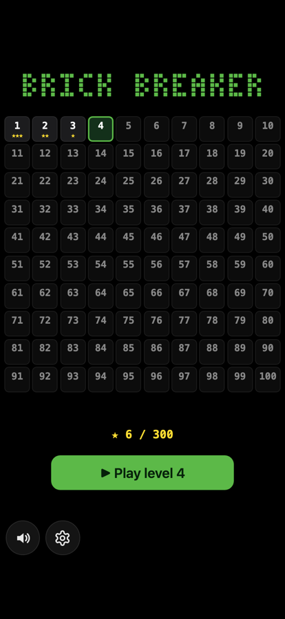
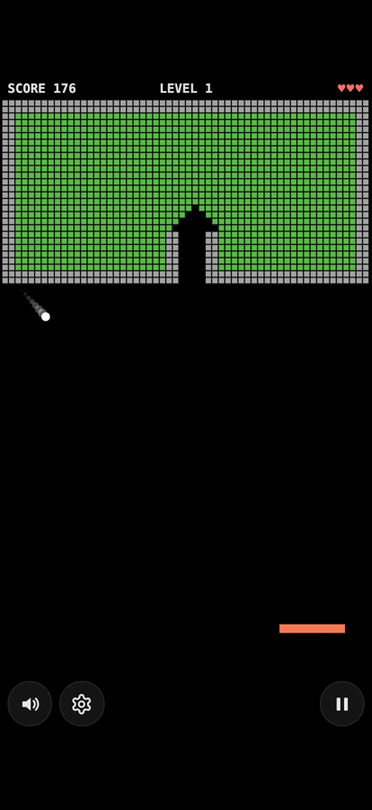
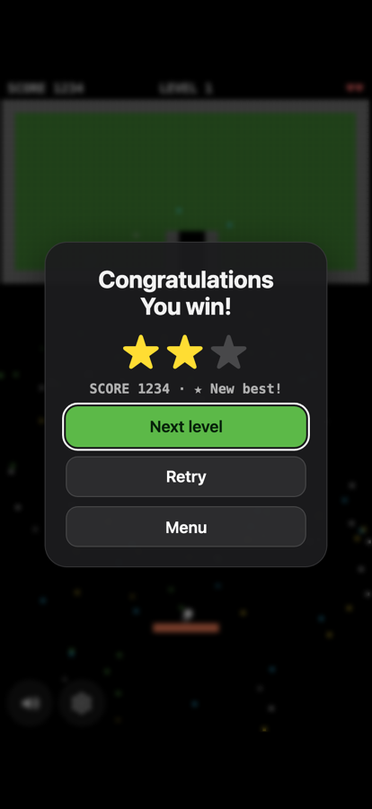

# Brick Breaker

A pixel-art Breakout game with 100 levels of dense brick fields sealed behind unbreakable steel walls. The only way in is a steel canal: send the ball up it, and every hit crumbles a chunk of bricks so the field caves in from the inside.

**Play it now:** https://rezgaraam.github.io/brick-breaker/ (works offline; on iPhone, Safari → Share → Add to Home Screen)

<p>
  
  
  
</p>

## Features

- 100 levels, generated from the level number: canal fields, inner steel rooms, bands, diamonds, hand-drawn maps and a hand-built finale. Every level is sealed in a steel frame with at least one steel canal
- Bricks crumble: a hit breaks every brick within 3 steps, but never through steel
- Power-ups: multi-ball (x3, +3), wide paddle, fireball, slow ball, extra life, and two bad ones
- Combo scoring, 1 to 3 stars per level, best score per level
- Synthesized sound effects and music, no audio files
- Pause (also automatic when you leave the app or get a call)
- Settings: music, sound effects, haptics (iPhone), screen shake, ball speed, paddle control (follow finger or drag), assisted play for players who can't steer, language
- English, French, German, Spanish and Persian
- Accessible: real buttons for every control, VoiceOver labels, reduced-motion support
- One `index.html`, no dependencies, no build step

The iOS app wraps the same page in a native shell and adds a SwiftData progress store, a native Progress screen and haptics.

## Run it

**Web:** open `index.html` in a browser. The service worker needs a server: `python3 -m http.server 8000`.

**iOS** (Xcode, built and tested with Xcode 27, plus [XcodeGen](https://github.com/yonaskolb/XcodeGen)):

```bash
cd ios && xcodegen generate && open BrickBreaker.xcodeproj   # then ⌘R on a simulator
```

On your own iPhone, put your team ID in an untracked file, plug the phone in, and run one script:

```bash
echo 'DEVELOPMENT_TEAM = <your team ID>' > ios/Local.xcconfig
ios/run-device.sh
```

A free Apple account works; the app then needs reinstalling every 7 days.

## Tests

| Command | Checks |
|---|---|
| `node test.js` | All 100 levels sealed with a canal and every brick reachable; balls never enter or pass steel (fireball included); canal seams; crumble; broken storage still loads; pause, assisted play, translations |
| `node bench.js <chromium> "$PWD/index.html"` | No dropped frames on level 100 with 20 balls at 4x CPU throttle |
| `node pwa-check.js <chromium> .` | Installable, cached, loads offline |
| `ios/check.sh` | Swift package tests, simulator build, UI tests, Apple accessibility audits |

`CLAUDE.md` describes the architecture and the invariants the tests protect.
